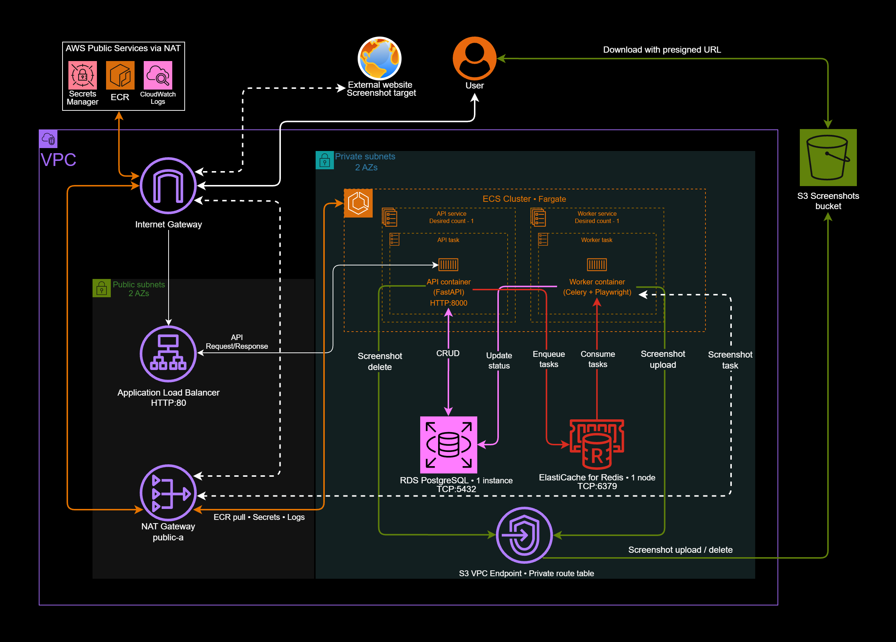
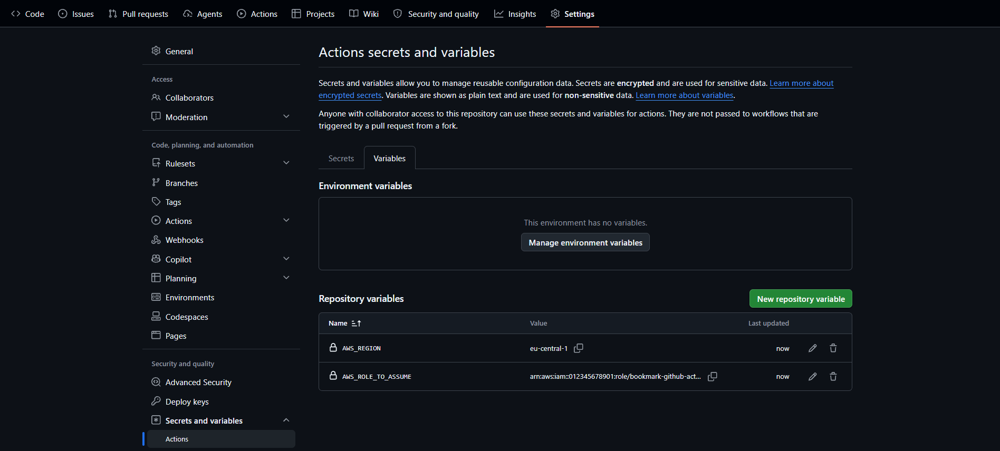

# Bookmark

This is my personal portfolio project demonstrating a containerized bookmark manager built from scratch using FastAPI, GitHub Actions, and AWS provisioned with Terraform. What started as a small sandbox/learning project has over time evolved into a clean, modern backend architecture featuring infrastructure as code, CI/CD pipelines, automated testing, and background processing, with everything hosted on AWS.

## Features

- User registration and authentication using JWT
- Full CRUD Operations - bookmark management with sorting and pagination
- Background screenshot generation using Celery and Playwright.
- Screenshot storage in Amazon S3
- PostgreSQL database with Alembic schema migrations
- Local development environment using Docker Compose
- AWS infrastructure provisioned with Terraform
- CI/CD pipeline using GitHub Actions

## Architecture
- **Application Load Balancer** receives HTTP traffic and forwards it to the API
- **ECS Fargate** runs FastAPI application and Celery worker
- **Amazon RDS for PostgreSQL** works as database for users and bookmarks
- **Amazon S3** stores screenshots
- **Amazon ElastiCache for Redis** provides the Celery message broker
- **AWS Secrets Manager** manages sensitive configuration
- **Amazon CloudWatch Logs** collects application logs
- **Terraform** provisions the AWS infrastructure

## Architecture diagram



## Technology Stack

- **Backend:** Python, FastAPI, PostgreSQL, SQLAlchemy, Alembic, Pytest, JWT
- **Background Processing:** Celery, Redis, Playwright
- **Containers & Cloud:** Docker, AWS (ALB, VPC, IAM, S3, ECS Fargate, RDS, ElastiCache, Secrets Manager, CloudWatch)
- **DevOps / CI-CD:** Terraform, GitHub Actions

## CI/CD

The GitHub Actions workflow is located in `.github/workflows/ci.yml`

### CI - Pull Request & Push to `main`

1. Start PostgreSQL.
2. Install dependencies.
3. Apply Alembic migrations to the CI database.
4. Run tests against PostgreSQL.

### CD - push to `main` after CI succeeds

1. GitHub Actions recieves temporary AWS credentials through OIDC.
2. Docker builds new image tagged with commit SHA, and pushes it to ECR.
3. Terraform applies the infrastructure changes, and update the ECS tasks with latest image.

>The workflow uses GitHub OIDC. The AWS IAM trust policy defines which GitHub repository and branch can assume the deployment role.

## Local Deployment
>Docker Compose does not include a local S3-compatible service, as a result, screenshot generation and retrieval does not work.
### Requirements

Docker Desktop with Docker Compose and Git

### Run the application

Clone the repository:

```bash
git clone https://github.com/Krupsinko/Bookmark.git
cd Bookmark
```

Start the local services:

```bash
docker compose up --build
```

Docker Compose starts the API, Celery worker, PostgreSQL and Redis.

The API is available at:

- `http://localhost:8000`
- `http://localhost:8000/docs` - Interactive API documentation with Swagger UI

Stop the services:

```bash
docker compose down
```

Remove the local PostgreSQL volume:

```bash
docker compose down -v
```

## Terraform

Terraform configuration is split into two directories:

- `terraform/bootstrap` - Long-lived resources containing ECR registry, GitHub OIDC trust policies, roles and the S3 bucket for the remote Terraform state. You run this once manually.
- `terraform/app` - Actual application infrastructure such as VPC, ECS,
  ALB, RDS, Redis, S3, and CloudWatch. Fully automated by GitHub Actions.

Application infrastructure can be destroyed independently of the
bootstrap resources.

**Cost note:** Resources created by terraform incur charges while running. 
Destroy the application infrastructure when it is no longer needed.

## Configuration
### 1. Manually configure variables required by bootstrap.

- `terraform/bootstrap/terraform.tfvars`:
  - `aws_region` - AWS region where the resources will be created.
  - `github_repository` - GitHub repository allowed to use the OIDC role in OWNER/REPOSITORY format.
  - `github_branch` - Branch allowed to use the OIDC role.

**Example `terraform.tfvars`**

```hcl
aws_region        = "eu-central-1"
github_repository = "your-username/Bookmark"
github_branch     = "main"
```
### 2. Apply the bootstrap configuration

```bash
cd terraform/bootstrap
terraform init
terraform apply
```

After Terraform completes, get the ARN of the GitHub Actions role

```bash
terraform output -raw github_actions_role_arn
```
Copy the output, it should look something like that - `arn:aws:iam::012345678901:role/bookmark-github-actions`

### 3. Create GitHub actions variables
The GitHub Actions workflow requires repository variables. You can find them in Settings → Secrets and variables → Actions → Variables → New repository variable:
- AWS_REGION - Region that was used in `terraform.tfvars`
- AWS_ROLE_TO_ASSUME - ARN returned by `terraform output -raw github_actions_role_arn`



## Testing

Project uses pytest and a PostgreSQL service in GitHub Actions.

Run the tests locally in an environment with the required
dependencies and test database configured:

```bash
pytest
```

## Project Structure

```text
├── .github/
│   └── workflows/
│       └── ci.yml
├── alembic/
│   └── versions/
├── app/
│   ├── db/
│   ├── routers/
│   ├── schemas/
│   └── config.py
├── tests/
├── terraform/
│   ├── app/
│   └── bootstrap/
├── worker/
├── Dockerfile
├── docker-compose.yml
├── requirements.txt
└── requirements-test.txt
```

## Limitations

This portfolio project is demonstrating backend development,
AWS infrastructure and CI/CD automation. It is not production-ready
service.

Further improvements include:

- Adding HTTPS support to the ALB using an ACM certificate for a custom domain.
- Tightening IAM permissions for GitHub Actions OIDC role.
- Adding a local S3 screenshot storage to Docker Compose 